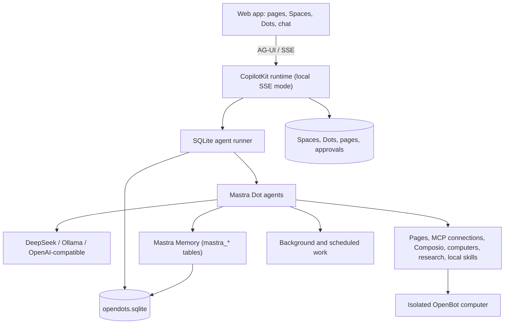

<div align="center">

# OpenDots

### Always-on AI coworkers that move between text and calls — fully self-hosted.

**An open-source template for persistent AI agents, each with its own computer. Conversations stay on your machine.**

Built with [Mastra](https://mastra.ai) and [AG-UI](https://docs.ag-ui.com/introduction). · [Get started](#get-started) · [Overview](#overview) · [Architecture](#architecture) · [Features](#features) · [Contributing](CONTRIBUTING.md)

[](https://github.com/AndyCyberSec/OpenDots_Mastra/actions/workflows/ci.yml)
[](./LICENSE)


<a href="https://trendshift.io/repositories/275323" target="_blank"></a>

Host OpenDots on your own infrastructure. **No CopilotKit Intelligence account, subscription, license activation, or hosted conversation service is required.** Agents run locally on Mastra, conversations and memory persist in the workspace SQLite file, and the model provider is your choice: DeepSeek, Ollama, or any OpenAI-compatible endpoint.

This repository is a self-hosted fork of [CopilotKit/OpenDots](https://github.com/CopilotKit/OpenDots). The upstream project remains the reference implementation; see [the migration notes](docs/MASTRA_MIGRATION.md) for what changed and [known limitations](docs/MASTRA_MIGRATION.md#known-limitations) for what was not carried over.

</div>

---

<div align="center">

<table><tr><td>

https://github.com/user-attachments/assets/4c74fe7d-ecdd-42dd-95da-5d34f9b9576e

</td></tr></table>

</div>

_Ask → browse → approve → save. A live computer view and a human review card appear right in chat, then the approved draft becomes an editable Space page. Enlarged for readability; idle time is trimmed and playback is accelerated._

## Overview

OpenDots is a starting point for building your own agent workspace. Clone it, define your Dots, connect your services, and adapt the interface and tools to your needs.

**A template, not a hosted product.** You run the application and configure its infrastructure. The template is in early development; the Features section below describes what's included and distinguishes local verification from connected-service testing.

### Spaces

A Space is a home for working documents. Dots appear separately in navigation and can be granted access to multiple Spaces in their settings. Each Dot has a default destination for saved pages; existing installations retain their original Space access. Browse pages in a searchable library, switch between grid and list views, and organize documents as nested subpages. Open a page in a focused visual editor with formatting, slash commands, and undo/redo. Write directly, save a conversation as a page, or ask a specialist to create and revise content.

Pages stay in the local workspace database. Their conversations use CopilotKit Threads, with a separate conversation for each page and specialist. Page links connect the document workspace to Dot chat. Manual editing works before you configure conversation services. Autosave reports its progress, failed saves retain your draft, and revision checks prevent stale edits from overwriting newer content. Markdown source mode remains available.

<div align="center">

<table><tr><td>

https://github.com/user-attachments/assets/d20c3405-4339-49e7-a799-43298728015c

</td></tr></table>

</div>

_Open a Space, navigate to its launch brief, ask Scout about the saved page, and continue in Dot chat. This recording uses live page chat and example launch content._

### Specialist Dots

Give each Dot a name, role, instructions, and permitted tools. A researcher can investigate a topic; a writer can turn findings into a draft. Inspect their work and control what they can do.

### Dot computers

Each Dot can have its own computer, using [OpenBot](https://github.com/CopilotKit/OpenBot)'s container supervisor and computer service. Its browser profile and workspace files persist across stop/start. The Computer panel exposes browser control, human takeover, files, terminal output, and activity, with browser, file, and shell permissions set per Dot. The application keeps service credentials on the server and derives a different computer credential for each Dot.

See [Computer setup](docs/COMPUTERS.md) to build the pinned services and connect your deployment. Computer tools require those services; an unconfigured template does not execute commands on your host.

<div align="center">

<table><tr><td>

https://github.com/user-attachments/assets/30b691c3-0f66-4964-9fdb-67d4feab5568

</td></tr></table>

</div>

_Ask Scout to open a website, summarize it, save notes, and verify the file. Every computer action in this demo is requested through chat; CopilotKit tool renderers show the live browser, saved file, and terminal output inline._

### Review before saving

Ask a Dot to show a draft before saving it. A CopilotKit human-in-the-loop card pauses the conversation for **Approve & save** or **Decline**. Approval creates the page in an authorized Space and returns a link; retries with the same draft recover that saved page. A changed draft needs a new review. The agent continues after your decision.

### Connections

Give a Dot tools from any MCP server, such as email, calendar, GitHub, or your own services. Read-only tools run on their own. Any other tool pauses for an **Approve & run** card in chat, and only your approval runs it. You can turn each tool on or off per Dot. See [Connections](docs/CONNECTIONS.md).

### Connected apps

Dots can use [Composio](https://composio.dev) to work with the owner's email, calendar, and other connected apps. Add `COMPOSIO_API_KEY`, restart OpenDots, then enable Connected apps in both the global settings and the Dot's settings. Adding the API key alone does not grant access.

You can limit each Dot to toolkit slugs such as `gmail` or `google_calendar`. A blank toolkit list allows every toolkit in the Composio project. OpenDots identifies the owner with `OWNER_ID`, so keep that value stable after connecting accounts. When a tool needs authentication, the Dot returns a Connect link in chat for the owner to complete the provider's sign-in flow.

These tools act on real accounts. Start with a read-only request and use a test account before trying write actions. See [Composio setup](docs/SETUP.md#composio) for configuration, permissions, testing, and data-sharing details.

### Text and calls

A continuous conversation keeps the Dot's avatar and status above the messages, with text and call controls close at hand. Work updates, source links, and call receipts appear in the timeline; a side panel shows results or the agent's computer.

Calls pair realtime speech with a separate compute agent, so the conversation can continue while longer work runs. Both use the same conversation context and tool permissions. The call screen includes a live timer, separate user and Dot captions, microphone mute, speaker mute, and a minimized view for continuing in chat. Voice needs separate provider configuration.

<div align="center">

<table><tr><td>

https://github.com/user-attachments/assets/3c06cf71-39ed-4e2b-b846-5463b2722389

</td></tr></table>

</div>

_Connect, talk, mute, minimize, and return to chat. This is a silent screen capture of a real call, with waiting time trimmed and playback accelerated._

### Slack

The managed Slack integration depended on CopilotKit Intelligence Channels and is **not part of this self-hosted fork**. No Slack tokens are read and no Slack connection is attempted. Everything else in this document works without it. See [known limitations](docs/MASTRA_MIGRATION.md#known-limitations) if you want to reintroduce Slack with a local bot.

## Architecture

### AG-UI connects the agent to the interface

[AG-UI](https://docs.ag-ui.com/introduction) carries streamed messages, tool calls, and agent state between the backend and the React app. Computer activity appears inline as the agent works; human-in-the-loop cards pause a tool call for your decision before it continues.

[Mastra](https://mastra.ai) runs every Dot: model calls, tool loops, memory, and workflows. The MIT-licensed CopilotKit runtime is used **only as the local AG-UI transport** and thread endpoint layer (SSE mode). It runs with a SQLite-backed runner and no Intelligence client. All agent orchestration, persistence, and memory are local.



Credentials stay on the server. Missing configuration produces a clear setup state instead of a crash, and automated tests use fixtures rather than paid provider calls. See [architecture decisions](docs/ARCHITECTURE_DECISIONS.md), [database schema](docs/DATABASE.md), and the [license audit](docs/LICENSE_AUDIT.md).

[OpenMuse](https://github.com/CopilotKit/OpenMuse) and [OpenBot](https://github.com/CopilotKit/openbot) remain code references for persistent work, agent computers, and execution controls.

## Get started

Use **Node.js 24** and **npm**. Docker is only needed for the optional OpenBot computer service.

```sh
git clone https://github.com/AndyCyberSec/OpenDots_Mastra.git
cd OpenDots_Mastra
npm ci
cp .env.example .env
# edit .env: set AI_PROVIDER, AI_BASE_URL, AI_API_KEY, AI_MODEL
npm run dev
```

Open **http://127.0.0.1:5173**. You can create Spaces, write pages, and configure Dots before configuring a model.

### DeepSeek

```env
AI_PROVIDER=openai-compatible
AI_BASE_URL=https://api.deepseek.com
AI_API_KEY=your-deepseek-api-key
AI_MODEL=deepseek-chat
```

### Ollama

```env
AI_PROVIDER=ollama
AI_BASE_URL=http://127.0.0.1:11434/v1
AI_MODEL=llama3.1
```

Any OpenAI-compatible endpoint works the same way. `OPENAI_API_KEY`, `OPENAI_BASE_URL`, and `OPENAI_MODEL` are still read for existing deployments. A Dot may override the workspace model with its own model id; OpenDots never switches provider or model on its own.

### Local network access

OpenDots binds to `127.0.0.1` by default. To reach it from another device on your LAN, set `HOST=0.0.0.0` (or your LAN address) **and** a random `OWNER_TOKEN` of at least 24 characters. The token is required for every API request and is also the browser login. Keep SQLite, Ollama, the browser service, and the OpenBot supervisor off untrusted networks.

See [Setup](docs/SETUP.md) for calls, the browser service, computers, Docker, and LAN hardening.

## Data and privacy

Conversations, tool calls, approval receipts, run events, and Mastra memory are stored in the local SQLite file (`DATABASE_PATH`, default `data/opendots.sqlite`). Conversations survive restarts and have no framework-imposed retention limit; delete the file or the thread to remove them. There is no hosted conversation database.

The configured model provider receives conversation context, including authorized page content and tool results. **Local inference is local only when you point the base URL at a local server such as Ollama.** Public-web research sends queries and selected URLs to Parallel unless you set `WEB_SEARCH_PROVIDER=disabled` or configure the isolated browser. Connected apps send tool arguments through Composio and the app provider. Speech sends audio to the configured speech provider.

**OpenDots sends no telemetry.** The setup-event transport from the upstream template was removed, and the bundled AG-UI runtime is opted out of its own usage telemetry (`DO_NOT_TRACK=1`) before it is imported. No licensing or activation server is contacted. See [telemetry notes](docs/MASTRA_MIGRATION.md#telemetry).

## Features

| Area                       | Included                                                                                                             |
| -------------------------- | -------------------------------------------------------------------------------------------------------------------- |
| Spaces and Specialist Dots | Saved names, role instructions, and per-Dot research and memory permissions                                          |
| Pages                      | Searchable library, visual editor, slash commands, autosave, and revision checks                                     |
| Conversations              | Local SQLite transcripts, page-specific conversations, source links, durable replay across restarts                  |
| Agent runtime              | Mastra agents per Dot with provider-independent model configuration                                                  |
| Calls                      | WebRTC speech, delegated compute, bounded sessions, hangup, and timeline receipts                                    |
| Background work            | Scheduled server-side turns in their original conversation, with pause and retry controls                            |
| Browser                    | Separate read-only public-page service with page capture and navigation limits                                       |
| Dot computers              | Per-Dot browser profiles, files, shell, takeover, permissions, and action records through OpenBot                    |
| Connections                | Per-Dot MCP servers, Composio connected apps, per-tool access, and owner approval for MCP write actions              |
| Appearance                 | System, light, and dark themes; dark colors are derived at build time from the light styles                          |
| Memory                     | Mastra memory in the local database plus user-managed preferences that permitted Dots can use                        |
| Local skills               | Per-Dot delivery of `SKILLS_DIR` skills (a folder with `SKILL.md` and reference files); see [skills](docs/SKILLS.md) |
| Deployment                 | Local Node setup and separate application/browser containers                                                         |

Scheduled tasks run in their original conversation. If a worker stops or its lease expires during a run, OpenDots marks that run **Interrupted** and waits for an explicit retry. Review its pages and computer actions, then use **Retry after review** when appropriate. Completed effects may already be present even when a run has no final result.

Local checks cover setup, SQLite migrations, durable conversation persistence and replay, permissions, human approvals, streaming, cancellation, timeouts, LAN origin rules, and browser isolation. Automated tests use a local OpenAI-compatible fixture server; they never call a paid provider. **Mastra streaming, tool execution, human-in-the-loop tool hand-off, restart persistence, and the local AG-UI HTTP surface are covered by automated integration tests.**

Live OpenBot computer browsing, file creation, shell verification, persistent files, and live Realtime speech still require your own configured services. See [known limitations](docs/MASTRA_MIGRATION.md#known-limitations) for the remaining verification gaps.

This is a single-owner starting point. Shared editing, invitations, file uploads, and interactive page embeds are not included. Schedules are recurring instructions, not a complete goal or event-trigger system. Specialist Dots have separate roles and conversations; multi-Dot group conversations and automatic delegation are further work.

### Extending the template

- Add identity, Space membership, and shared page editing for multi-user deployments.
- Add file attachments and richer page content.
- Add event triggers and a persistent responsibility lifecycle.
- Extend tools and approval flows for your own workflows.
- Add richer artifacts, connected-app context, and specialist coordination.

## Contributing

See [Contributing](CONTRIBUTING.md) for development guidance and [Security](SECURITY.md) for reporting issues. Contributions should describe the workflow they enable, include verification evidence, and distinguish live integrations from fixtures.

## References

- [Mastra documentation](https://mastra.ai/docs)
- [AG-UI documentation](https://docs.ag-ui.com/introduction)
- [CopilotKit OpenDots (upstream)](https://github.com/CopilotKit/OpenDots)
- [OpenMuse](https://github.com/CopilotKit/OpenMuse)
- [OpenBot](https://github.com/CopilotKit/openbot)

## License

[MIT](LICENSE). OpenDots is a fork of CopilotKit's MIT-licensed OpenDots template; original copyright and attribution are preserved. See [license audit](docs/LICENSE_AUDIT.md) for the full dependency assessment.

## Public-web research

Parallel is selected by default in live research and Dot conversations. Ask a topic-only question to discover and read up to five sources, or supply URLs to extract them directly. Sources are saved with their links. A browser worker is not required for this research path; computer tools remain available for interactive work.

`WEB_SEARCH_PROVIDER=browser` preserves the existing URL-only browser reader, and `WEB_SEARCH_PROVIDER=disabled` disables these research tools. Workspace and Dot research permissions, pause and cancellation controls still apply. Sample research remains fictional and does not contact a provider.

Queries, requested URLs, a stable session identifier and the research objective are sent to `https://search.parallel.ai/mcp`. Memories and complete conversations are not automatically forwarded to Parallel. Model-selected objectives may still contain context from the conversation. The anonymous service is free for light use with provider-managed limits; set `PARALLEL_API_KEY` on the server for production or higher limits. Provider errors and empty results are reported rather than replaced with invented evidence. See [Parallel Search MCP documentation](https://docs.parallel.ai/integrations/mcp/search-mcp).
